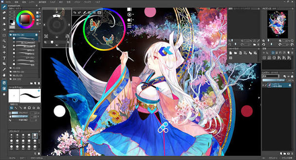
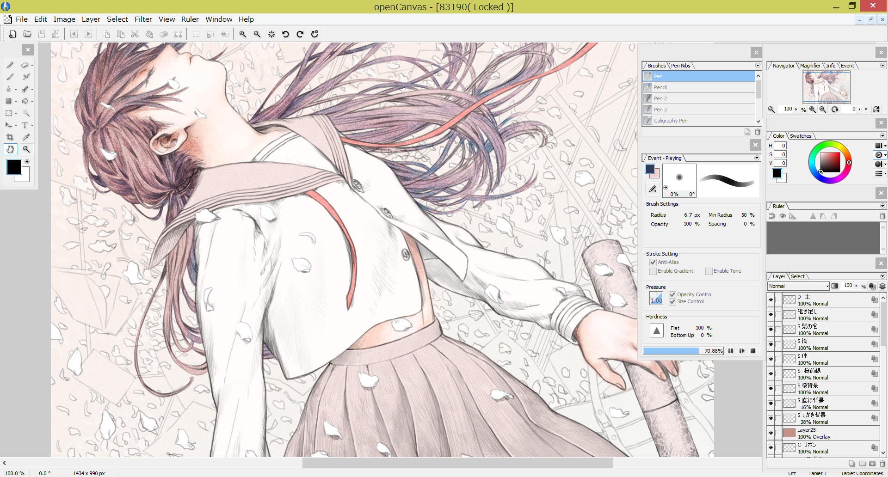
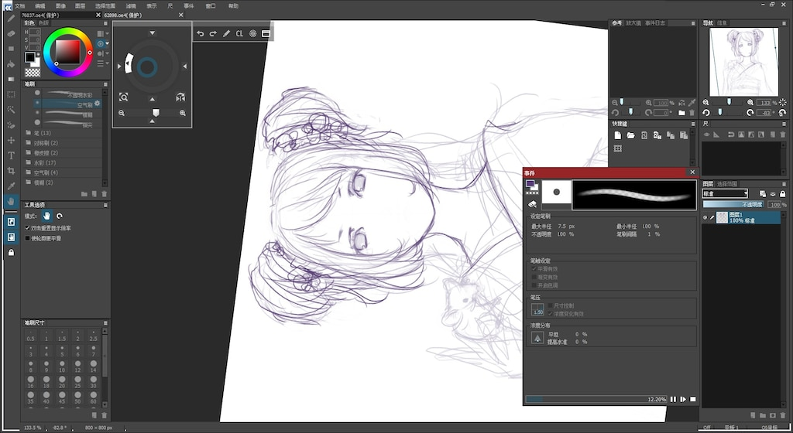

# openCanvas Drawing Sessions With Colour and Replay

A finished illustration shows the result, while its drawing history can explain how that result was reached.
openCanvas 7 combines painting tools, layers, rulers, and Event playback for artists working on Windows.
Keep the editable artwork and the recorded process together when you want to revise a technique or explain it to someone else.

[](https://opencanvas-7.github.io/opencanvas/)

## Use Event playback to examine drawing decisions

The openCanvas Event function records and replays the drawing procedure.
It can help reveal the order in which line work, colour, brush settings, and corrections contribute to an illustration.

During a short study, choose one decision to observe:

- How the initial sketch becomes a clearer silhouette.
- Where the first major colour areas are established.
- Which strokes describe an edge and which soften it.
- When a correction improves the composition.
- How layer changes affect the final appearance.

Save the work and its event data before experimenting with another direction.
Review the relevant passage at a useful playback speed rather than judging only the completed image.



For a teaching example, explain what changes during the replay.
A viewer will learn more from a specific observation about edges or values than from an unexplained sequence of strokes.

The product also provides a Making GIF function for presenting a drawing process.
Keep the original event material available when a short presentation omits decisions that may matter later.

## Set a colour boundary for a small study

Choose a manageable colour range before exploring every available brush.
A limited set makes it easier to see whether a problem comes from value, temperature, or saturation.

Five supplied palette references offer different starting points:

- [Classic_4.gpl](palettes/Classic_4.gpl): a small set described as figure-painting pigment approximations.
- [Greys16.gpl](palettes/Greys16.gpl): a greyscale ramp for value comparisons.
- [MyPaint_Default.gpl](palettes/MyPaint_Default.gpl): the bundled default collection.
- [All_color_choice.gpl](palettes/All_color_choice.gpl): a broader colour-selection reference.
- [Watercolor.gpl](palettes/Watercolor.gpl): a named collection for a separate colour study.

Treat the chosen colours as constraints for the exercise.
A palette name describes the collection; the appearance of a stroke still depends on brush behaviour and the surrounding colours.

To inspect the supplied GPL palette text, this Python example prints RGB entries as hexadecimal values:

```python
from pathlib import Path

palette = Path("palettes/Classic_4.gpl")
for line in palette.read_text(encoding="utf-8").splitlines():
    fields = line.split()
    if len(fields) >= 3 and all(value.isdecimal() for value in fields[:3]):
        red, green, blue = map(int, fields[:3])
        print(f"#{red:02X}{green:02X}{blue:02X}")
```

Use the printed values as a reference when choosing colours in a painting exercise.
Retain the palette's header comments with the original reference material.

## Compare brushes on the same subject

openCanvas includes pencil, pen, watercolour, and airbrush options with customisable presets.
Use a repeatable subject to compare them: one contour, one broad shape, and one transition between colours.

Keep the canvas scale and approximate stroke size similar during the comparison.
Change one setting at a time so that the resulting difference remains understandable.

A useful brush study contains:

1. A light stroke and a stronger stroke on a pressure-capable device.
2. A slow curve and a quicker directional mark.
3. An opaque area beside a translucent passage.
4. A transition across an existing painted region.
5. A small correction made with the same tool.



For temperature comparisons, use [Warm_Colors.gpl](palettes/Warm_Colors.gpl) alongside [Cool_Colors.gpl](palettes/Cool_Colors.gpl).
For quieter colour relationships, compare [Muted.gpl](palettes/Muted.gpl) with [Pastels.gpl](palettes/Pastels.gpl).
[Browns_And_Yellows.gpl](palettes/Browns_And_Yellows.gpl) and [Reds_And_Purples.gpl](palettes/Reds_And_Purples.gpl) provide further hue-group references.

Do not infer a brush's mixing behaviour from the selected colour names.
The companion [spectral.md](doc/spectral/spectral.md) collects background references on RGB transparency and subtractive colour mixing.

Use that reading to distinguish colour selection from the numerical model used by a painting application.
For openCanvas drawing software, inspect the actual stroke and save a preset when it produces a useful result.

## Give layers distinct editing responsibilities

Separate elements when they need independent revision.
For example, a background adjustment should not require repainting every line in a foreground object.

openCanvas supports layer sets for organising multiple layers.
Choose names that describe the content or editing purpose of each group.

| Editing purpose | Possible layer organisation | Review after a change |
|---|---|---|
| Sketch development | Keep construction marks separate from refined lines | The intended contour remains readable |
| Broad colour revision | Group related base-colour areas | Neighbouring colours still separate clearly |
| Light and shadow study | Keep experimental passages independently editable | The forms retain consistent lighting |
| Background adjustment | Isolate the environment from the main subject | The focal area still attracts attention |
| Lettering or annotations | Keep text independently editable | Words remain legible at delivery size |

Use visibility changes to test whether a layer is helping the image.
Before merging layers, save a version that preserves the editing choices you may need again.

For alternative colour schemes across copies of a study, compare [Zenburn.gpl](palettes/Zenburn.gpl), [Ubuntu.gpl](palettes/Ubuntu.gpl), and [Tango_Palette.gpl](palettes/Tango_Palette.gpl).
Keep the same layer structure while evaluating a different colour arrangement.

## Let rulers support the composition

Parallel and perspective rulers help organise repeated directions and constructed spaces.
Establish the important axes before adding small background details.

For an architectural sketch, check:

- The position of the horizon relative to the subject.
- The direction of the major edges.
- The relationship between repeated shapes.
- The scale of the foreground and background objects.
- Whether the guided lines support the intended focal area.

Use freehand marks where the drawing needs a different character.
A ruler can improve consistency without deciding which lines deserve emphasis.

Rotate or zoom the canvas for a comfortable working view.
Return to the intended presentation orientation before assessing the composition.

## Prepare both an editable handoff and a viewing copy

openCanvas supports PSD saving for exchanging layered artwork with other applications.
Most layer information and layer modes can be retained, but differences in compositing algorithms can change the displayed result.

Open the exchanged file in the destination application and compare it with a flattened reference.
Inspect transparency, layer visibility, and any appearance affected by blending.

Keep the native project and event material with the editable handoff.
A viewing copy serves a different purpose: it should show the intended composition clearly without requiring the recipient to manage layers.

For a PNG export prepared for review, this Pillow example creates a smaller JPEG with a white background:

```python
from PIL import Image

with Image.open("illustration.png") as source:
    preview = source.convert("RGBA")
preview.thumbnail((1600, 1600), Image.Resampling.LANCZOS)
background = Image.new("RGBA", preview.size, (255, 255, 255, 255))
background.alpha_composite(preview)
background.convert("RGB").save("review.jpg", quality=92)
```

The maximum dimensions preserve the image's aspect ratio.
Choose a background that suits the review, and keep a transparent PNG separately when transparency is part of the delivery.



For colour-reference comparisons during handoff, [GIMP_Default.gpl](palettes/GIMP_Default.gpl) and [Gnome_Palette.gpl](palettes/Gnome_Palette.gpl) contain collections associated with other graphics tools.
[Visibone.gpl](palettes/Visibone.gpl) and [Visibone_2.gpl](palettes/Visibone_2.gpl) provide two arrangements to inspect.
[Creative_Commons.gpl](palettes/Creative_Commons.gpl) includes its own colour-source and attribution information.

Reference RGB values can help communicate a choice.
They do not guarantee identical appearance across displays, colour profiles, or different rendering settings.

## Keep a useful record of the session

Save enough context to repeat the study:

- Canvas dimensions and the intended viewing size.
- The brush presets used for significant passages.
- The colour references selected for the exercise.
- The purpose of the major layers and groups.
- The native project and associated event recording.
- The editable exchange file and final viewing copy.

When replaying an older session, note which decision you want to revisit.
Use a new working version for experiments so that the original sequence remains available for comparison.

## Related Search Terms

opencanvas 7, opencanvas, open canvas software, opencanvas drawing software, opencanvas event function, art, brushes, creative, drawing, graphics-tablet, painting, illustration, layers, digital-art, color-palette
